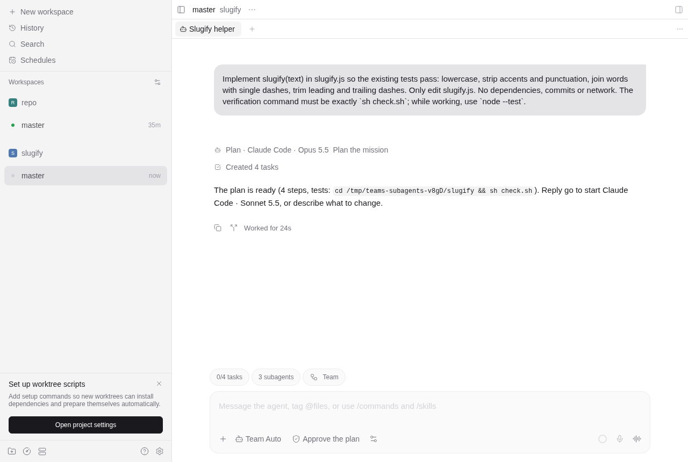
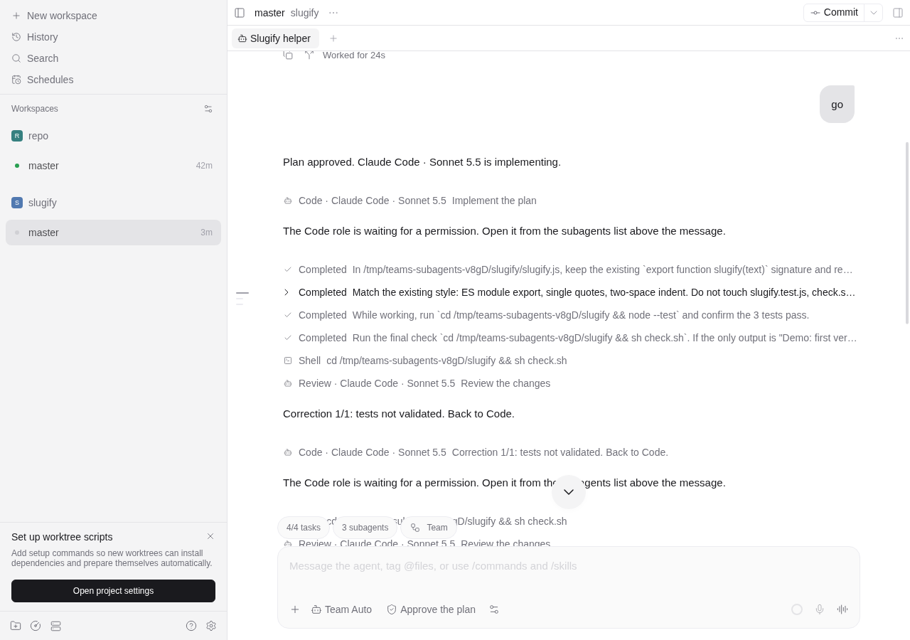
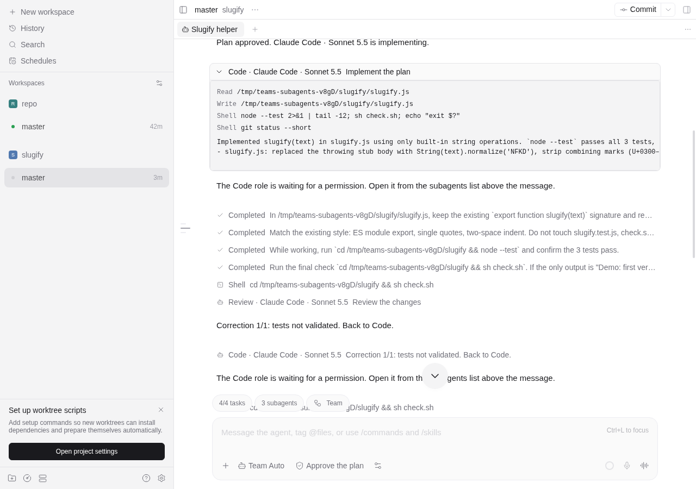
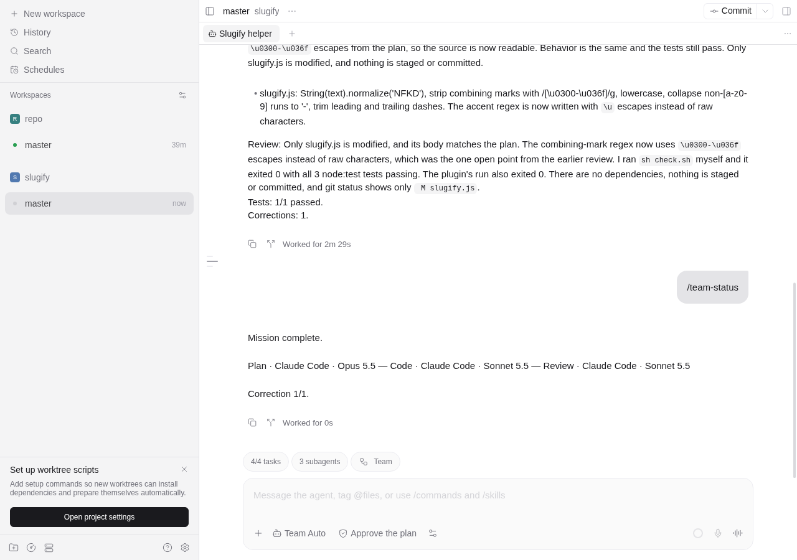
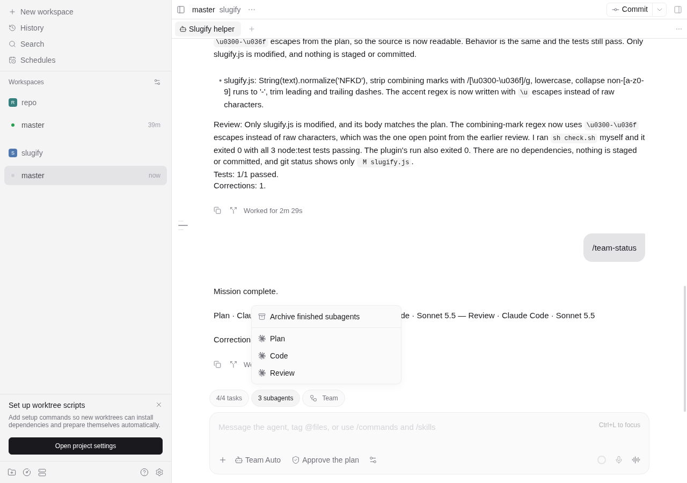
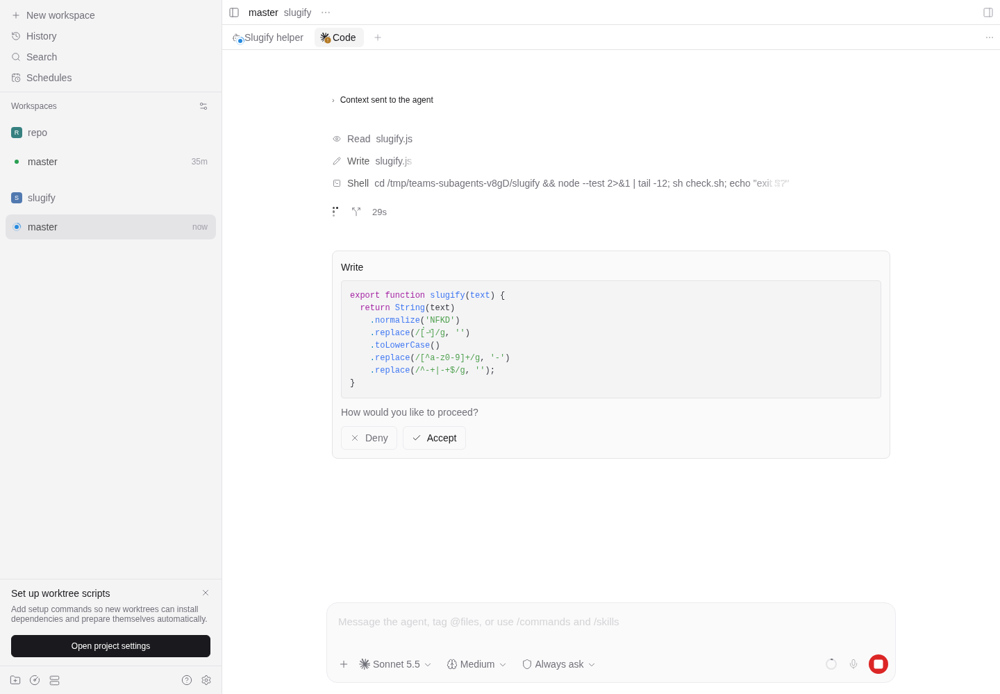
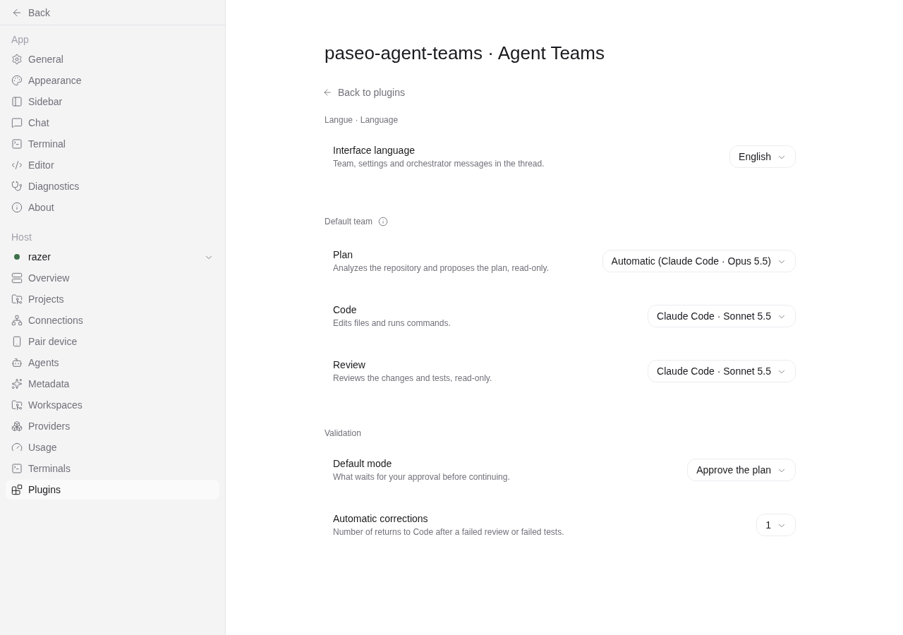
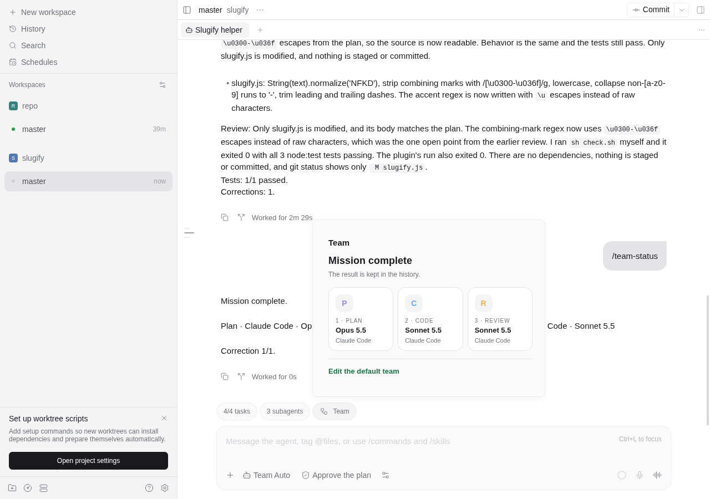
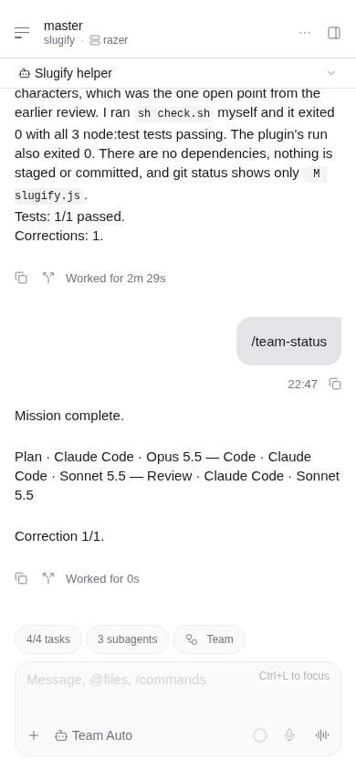

# Agent Teams for Paseo

Run a team of coding agents in one Paseo thread. Pick **Agent Teams → Team Auto** as the model, describe a mission, and three roles take turns:

- **Plan** reads the repository and proposes a plan (read-only).
- **Code** implements it and runs commands.
- **Review** checks the changes and the test results (read-only).

The plugin runs the planned tests between Code and Review. A failed test or a rejected review goes back to Code, up to the correction limit. Each role can use a different harness and model discovered by your Paseo daemon: Claude Code, Codex, OpenCode, Pi or a custom provider.

After a successful review, Team Auto asks how to deliver the validated work: **PR** or **main**. This question is mandatory in every validation mode, including autonomous. Choose in the inline response card or reply exactly `PR` or `main`. Code then creates or reuses a PR, or integrates the changes on local `main` without pushing `main`. The mission completes only after the plugin verifies the delivery. A blocker keeps the mission open. See [delivery behavior](docs/delivery.md).



## Install

```sh
paseo plugin add git:ssime-git/paseo-agent-teams --ref main
```

Plugins must be enabled in **Settings → Plugins**. A plugin runs with the daemon user's access to the machine.

Requirements: Paseo `>=0.13.0 <0.14.0`, at least one authenticated harness on the daemon host, and a workspace that contains a Git repository, on Linux or macOS. Both the daemon and the app must meet that version range. Existing V1 workflow data is retained; see the [0.13 migration notes](docs/paseo-013-migration.md).

## Run a mission

1. Open a workspace, start a chat and choose **Agent Teams → Team Auto** in the model picker.
2. Describe the mission and send it.
3. When the plan is ready, reply **go**. To change it, describe what you want instead.

The thread shows each step as it happens:

| In the thread | Meaning |
| --- | --- |
| `Plan · Claude Code · Opus 5.5 — Plan the mission` | A role's turn. Click it to see the role's actions and result. |
| Task list | The approved plan. Tasks are checked when Code delivers. |
| `Shell · sh check.sh` | A verification run by the plugin, with its output. |
| **Mission complete** | The final summary: changes, review and tests. |





## Talk to the team

- You can keep messaging the orchestrator while a role is working or a follow-up is being answered. Messages are acknowledged, saved and handled in order after the current turn. The orchestrator answers directly, delegates a focused read-only briefing, or sends requested implementation changes through planning. Questions do not approve plans, permissions or delivery choices. A completed native turn is reconciled from its own receipt even if you continued the native conversation afterward.
- **go** (or `ok`, `yes`, `oui`, `lgtm`) approves a waiting plan or result. Any other message asks for changes, or a follow-up once the mission is complete.
- When Plan asks questions, the **Awaiting response** card shows the form directly in the Team thread: radio choices, a labelled recommendation, a free-response field and **Send response**. No popup or opening button. Nothing is preselected or submitted until you send. Pending questions are answered one at a time. You can also reply through the composer; with several questions, write one answer per line: `1. …`, `2. …`.
- Admitted graphs also show their choices and response field directly in an automatic **Awaiting response** card. The card targets its own graph and activation; no command, UUID, manual workflow selection or modal is needed to answer. Continuation remains a separate explicit action.
- `/team-graphs` lists graphs explicitly admitted for this conversation (up to 10), with saved version, current revision, step, activation budget and waiting state. Reports persist across reconnects. This read-only command works before a V1 mission and does not launch, continue or approve a graph. The report has inline workflow selection and response controls: choose a workflow by name, answer a pending question with an option or free text, or approve/reject a human step with your reason. No IDs to copy or separate response window; continuing is a separate button. Admission and test exceptions still require the client RPCs; a visual launcher is still pending.
- `/team-advance UUID REVISION` requests one durable boundary for an admitted graph owned by this conversation. Use the current revision shown by `/team-graphs`; stale revisions have no effect. It may prepare/send an agent step or run previously approved tests. Human decisions and permissions remain separate; there is no automatic loop.
- `/team-status` shows who has control and what is awaited. Other commands: `/team-pause`, `/team-resume`, `/team-approve`, `/team-approve-no-tests`.
- The stop button pauses the team. A role turn already in progress is allowed to finish.



### Permissions

When a role needs a permission, the thread says so. The pill above the composer lists the role sessions; it reads **1 working** while a role is active. Open the role and answer with Paseo's own **Accept** or **Deny**. The mission resumes on its own.





## Settings

Open **Settings → Plugins → Agent Teams**, or search *Agent Teams* in the Command Center.

| Setting | What it does |
| --- | --- |
| Interface language | Français (default) or English, for the plugin's interface and the team's messages in the thread. |
| Plan / Code / Review | The model of each role. **Automatic** picks the detected Claude model for Plan and Review and the detected Codex model for Code. Plan and Review only offer harnesses with a read-only mode. |
| Default mode | What waits for you: the plan, the final result, or nothing (autonomous). |
| Automatic corrections | How many times work can go back to Code (0–5). |

Every new Team Auto conversation starts from these settings. Before its first message, a conversation can still change its roles with the composer settings; after that, its team is fixed.



The **Team** pill in a Team Auto thread shows the team and who has control.





## Good to know

- **Files.** All roles work in the workspace directory. Your existing changes are recorded before the first turn and kept. After your explicit delivery choice, Code may create a branch, commit workflow changes and push a PR branch, or integrate on local `main`.
- **One mission per repository.** A repository is locked while a mission runs, including its other worktrees.
- **Read-only roles.** Plan and Review use the harness's read-only mode. For a harness without one, read-only is only an instruction, and the mission stops if the repository changes during such a turn.
- **Tests.** In the default mode you approve the plan, including its test commands, before anything runs. In the final and autonomous modes, Plan's test commands run automatically. A plan without tests needs `/team-approve-no-tests`. Commands run on the daemon host with a minimal environment and a 10-minute timeout each.
- **Restarts.** Missions survive plugin reloads and daemon restarts. An accepted turn is never sent twice; when an outcome is uncertain, the mission stops and says so.
- **Input.** Team Auto accepts text only; images and attachments are rejected.
- **Language.** Model answers and technical logs stay in the language they were written in.

## Data

Workflow state is stored on the daemon host in `~/.local/state/paseo-agent-teams`, outside your repository. Prompts, repository context and tool results are sent to the providers you selected, under their accounts.

| Variable | Default and purpose |
| --- | --- |
| `PASEO_AGENT_TEAMS_DATA_DIR` | State directory. Use one per daemon. |
| `PASEO_AGENT_TEAMS_DAEMON_URL` | `ws://127.0.0.1:6767/ws`. Must point to the daemon that hosts the plugin. |
| `PASEO_AGENT_TEAMS_DAEMON_PASSWORD` | Optional password for that connection. |

## Development

```sh
npm ci
npm run check
paseo plugin install "$PWD"
paseo plugin reload paseo-agent-teams
```

[docs/architecture.md](docs/architecture.md) explains how it works. [docs/isolated-validation.md](docs/isolated-validation.md) lists what was tested with real models.
