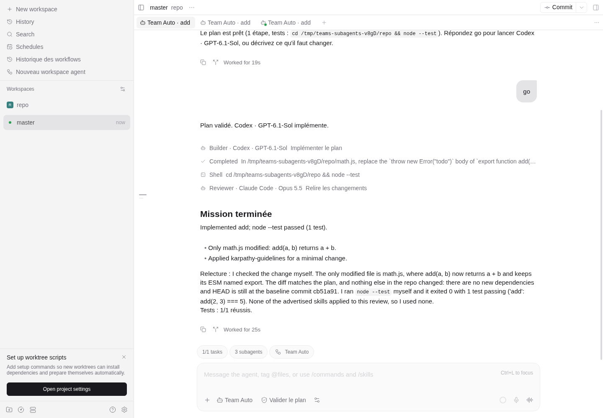
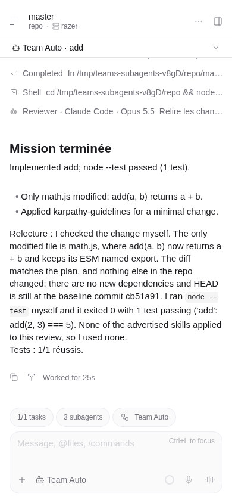
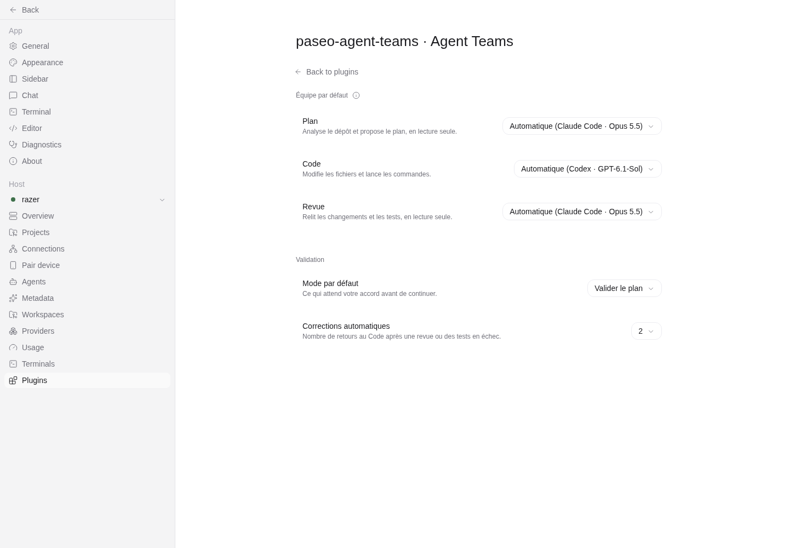
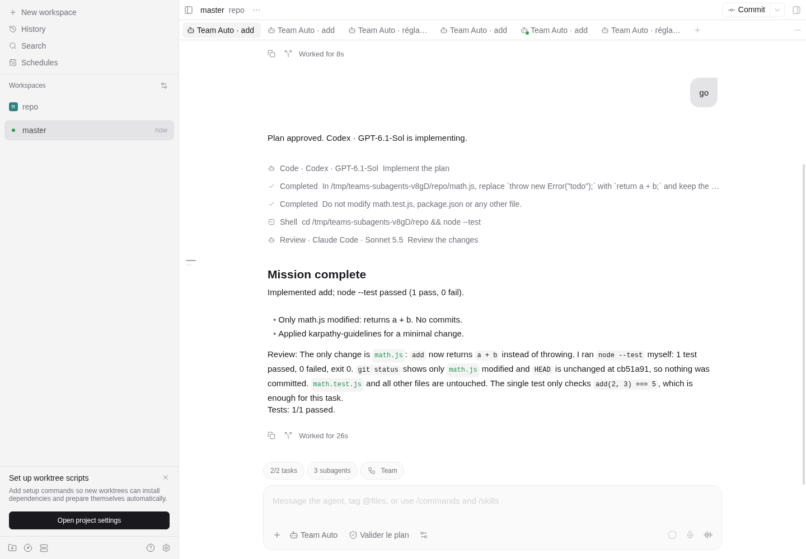

# paseo-agent-teams

A standalone Paseo plugin that turns several coding harnesses into one team. Choose **Agent Teams → Team Auto** in Paseo's model picker, describe a mission, and a Plan → Code → Tests → Review loop runs in that single thread, with the models discovered by your Paseo daemon (Claude Code, Codex, OpenCode, Pi and custom providers). No Paseo fork or client patch is needed.

- **One thread.** The orchestrator speaks in normal messages; each role turn is a native sub-agent row; the plan is a native task list; verification runs are Shell rows.
- **A default team in Paseo's settings.** Choose the model for each role, the validation mode, the number of automatic corrections and the interface language (French or English).
- **Persistent and recoverable.** Role sessions, approvals, corrections and test results survive plugin reloads and daemon restarts without resending accepted turns.
- **Advanced panel when you need it.** Manual Switch, full configuration, history and repository tools stay available from the Command Center.



## Quick start

1. Install the plugin (see [Install](#install-locally)) and open a workspace that contains a Git repository.
2. Start a chat and choose **Agent Teams → Team Auto** in the model picker.
3. Describe the mission in the composer and send it.
4. When the plan is ready, reply **go**, or describe what to change.

The team plans, implements, runs the planned tests and reviews the result. A failed review or failed tests go back to Code, within the correction limit.

## A mission in the thread

| What you see | What it is |
| --- | --- |
| Orchestrator messages | Native assistant messages: plan ready, questions, corrections, permissions, final summary. |
| `Plan · Claude Code · Opus 5.5 — Plan the mission` | One native sub-agent row per role turn. Expand it to see that role's actions (`[Shell] …`, `[Edit] …`) and its result. A correction cycle adds a new row. |
| Task list | The approved plan, as Paseo's native todo list. Tasks are checked once Code delivers. |
| `Shell · npm test` | The verification commands run by the plugin, with their output. |
| **N subagents** pill above the composer | Paseo's native list of the role sessions. The roles are child agents of the Team Auto thread, so they do not open separate tabs. Open one to read its full transcript or answer a pending permission. |
| **Équipe** / **Team** pill | The team for this thread and who has control, with links to the default-team settings and the advanced options. |




### Talking to the team

- **go** (or `ok`, `oui`, `yes`, `lgtm`, `vas-y`…) approves a waiting plan or result. Any other message is sent to the role that has control: a revision request at the plan checkpoint, a follow-up after completion.
- One open question is answered with your whole reply. Several questions are answered with one numbered line each (`1. …`, `2. …`).
- Commands: `/team-status`, `/team-pause`, `/team-resume`, `/team-approve`, and `/team-approve-no-tests` (explicit acceptance of a plan without tests).
- While a role works, the Team Auto turn stays open. Use the stop button to pause the team; a turn already accepted by a role is allowed to finish.
- Closing a Team Auto session pauses its unfinished workflow. After a daemon restart, the thread is replayed with the same messages and rows.

Team Auto accepts plain text. Images, attachments, output schemas, steering, custom system prompts, MCP servers, tool policies and provider options are rejected explicitly rather than silently discarded.

## Settings: default team and language

The interface is **French by default**. Open Paseo **Settings → Plugins → Agent Teams** to choose English; the Command Center entry is *Agent Teams · Équipe par défaut* (*Agent Teams · Default team* in English).

| Setting | Effect |
| --- | --- |
| Interface language | **Français** or **English**: Team card, settings, advanced panel, history and the orchestrator messages in the thread. Applies immediately. |
| Plan / Code / Review | Model for each role. **Automatic** picks the detected Claude model for Plan and Review and the detected Codex model for Code, with available alternatives. Plan and Review only offer harnesses with a read-only mode; Code only offers write-capable ones. A saved model that is no longer available falls back to the automatic pick, and the page says so. |
| Default mode | What waits for your approval: the plan, the final result, or autonomous validation. Missing tests are never approved silently. |
| Automatic corrections | Number of returns to Code after a failed review or failed tests (0–5). |

Every new Team Auto conversation starts from these settings. Before the first message, the composer settings still adjust the roles of that conversation; once a mission starts, its team is fixed.



About the language:

- Paseo 0.11.2 does not expose the app language to plugins, so the language is an explicit plugin setting. Hosts without the settings API keep the French interface.
- A language change applies at once to the Team pill, the card, the settings and the advanced panel, in every open client within about ten seconds. In a thread, messages and finished rows already shown keep their language; new rows and messages use the new one. After a daemon restart, the replayed thread uses the current language for rows and keeps the recorded messages as shown.
- Agent instructions are unchanged. Model answers, agent reports, engine event logs and technical errors appear as written by their source.



## Where things are

| Need | Place |
| --- | --- |
| Run a mission | Model picker → **Agent Teams → Team Auto**, then the thread |
| Change the default team or the language | Settings → Plugins → Agent Teams |
| See the team of a thread | **Équipe** / **Team** pill in a Team Auto thread |
| Read a role's full session | **N subagents** pill above the composer |
| Manual Switch, full configuration, repositories, export/import | Command Center → *Agent Teams · Options avancées* / *Advanced options* (in a workspace), or the same link in the team pill |
| All workflows on the host, including closed ones | Command Center → *Agent Teams · Historique* / *History* |

The plugin adds no sidebar entries and no pill to other harness threads.

A [proposed Paseo client extension](docs/upstream/README.md) can also show a team pill above the native New workspace composer. It is not part of released Paseo clients.

## Requirements

- Paseo daemon **0.11.2** and compatible connected clients (`>=0.11.2 <0.13.0`), including mobile 0.11.4 and desktop 0.12.0.
- Node.js 22.15 or later for development.
- At least one available, authenticated harness on the daemon host. Model IDs and modes are discovered from that host; no subscription or model availability is assumed.
- A workspace containing a Git repository, or a coordination directory with selected Git repositories, on a Linux/macOS daemon host. The test runner uses `/bin/sh` and POSIX process groups.

## Install locally

```sh
npm ci
npm run check
paseo plugin install "$PWD"
paseo plugin ls
```

Enable plugins yourself in **Settings → Plugins → Enable plugins** if necessary. An automated installer must obtain explicit permission before changing that global switch. Plugin installation trusts code running with the daemon user's machine access.

A reload recompiles the **registered source directory**. If the plugin was installed from Git, that directory is Paseo's internal checkout; changing your separate working copy does not change the app. For UI development, register the local project directory instead (after active agent turns have finished):

```sh
paseo plugin remove paseo-agent-teams
paseo plugin install /absolute/path/to/paseo-agent-teams
paseo plugin reload paseo-agent-teams
```

After source changes:

```sh
npm run check
paseo plugin reload paseo-agent-teams
```

Install from the public repository with:

```sh
paseo plugin add git:ssime-git/paseo-agent-teams --ref main
```

A fresh Git installation prepares its production SDK dependency automatically; an existing developer checkout keeps its installed development tools. The manifest runs `node server/prepare.mjs`. When the declared `@getpaseo/client` version is absent, this script runs `npm ci --omit=dev --ignore-scripts --no-audit --no-fund` against the committed lockfile. It skips installation when that version is already present so reloading a developer checkout does not prune development tools.

## Advanced panel

Button names below are the French labels; the English interface shows their translation.

The advanced panel is the full workflow surface: Manual Switch and Auto Workflow, per-role harness, model and permission, goal mode, repositories, test commands, export/import, recovery tools and the detailed workflow timeline. Team Auto and the panel use the same engine and the same saved workflows. In the panel and the API, the roles keep their contract names: Plan is the **planner**, Code the **builder** and Review the **reviewer**.


The panel also shows each verification command with its captured output:


Hand-offs between roles carry compact artifacts and a bounded diff rather than the whole conversation; the panel shows the hand-off size, and **fresh session per correction** (optional) restarts a role's session on each correction cycle.

### Configure a workflow

Choose each role's harness, discovered model and permission mode. Planner and Reviewer can use any discovered harness. Claude uses `plan`. For Codex, the plugin offers **Lecture seule (sandbox Codex)** even when discovery omits that mode: it maps to the advertised `auto` mode with native `sandbox_mode: read-only` and `approval_policy: never` options. A native `read-only` mode, when advertised, is retained. Claude read-only sessions also disable editing and native plan-mode transitions; approval stays in the plugin. OpenCode uses its native `plan` mode. Other harnesses use an advertised `read-only` mode when available; otherwise they offer **Lecture seule par consigne (sans sandbox)**. This choice sends read-only instructions and persists a repository fingerprint before dispatch. Any repository change during that turn, including after restart recovery, suspends the workflow without reverting files. This detects changes; it cannot prevent writes or attribute external changes to an agent. **Auto-accept du Code** uses the advertised native unattended mode (Claude `bypassPermissions`, Codex `full-access`) or the discovered `auto_accept` toggle when available. Remaining Builder tool permissions are answered automatically; questions and plan/mode changes require a response. Disable this switch to keep the selected Builder mode and answer permissions manually. Planner and Reviewer retain their read-only configuration. Existing saved configurations without this setting keep their previous permission policy.

Defaults for new panel workflows: Auto Workflow, human approval after the plan, Code auto-accept, automatic corrections, two correction cycles and explicit restart recovery. Team Auto conversations start from the default team in the settings and keep Code auto-accept off.

Enable **Poursuivre jusqu’à l’objectif** for continuous execution: the Builder develops **and tests**, failed verification returns for correction, and persistent review failures return to the Planner before execution continues. The default budget is 30 model turns / 2 hours, with compact context, independent review sessions, automatic recovery and per-harness native skill discovery. Goal mode authorizes verification command evolution after the first plan approval; explicit launch commands remain fixed. Existing stopped workflows offer the same button to start a diagnosis with a renewed budget. See [behavior, budgets and real mixed-provider validation](docs/goal-execution.md).

Providers without discovered model IDs offer an explicit **harness default (not advertised)** choice. It leaves model selection to that harness; the plugin never sends a made-up model ID. Providers with no mode catalog can likewise retain their native default permissions. Authentication, connected accounts and configured model catalogs remain the harness's responsibility. Unavailable/error providers cannot be launched; discovering a model does not guarantee access or credits.

#### Separate Claude accounts

The panel also discovers custom providers extending Claude or Codex. Configure a separate account on the daemon host using a dedicated directory, without logging out the default account:

```sh
CLAUDE_CONFIG_DIR="$HOME/.config/claude-fable" claude auth login --claudeai
```

After completing login, add an entry under `agents.providers` in the daemon's `config.json`, using an absolute path:

```json
{
  "claude-fable": {
    "extends": "claude",
    "label": "Claude — Fable credits",
    "env": { "CLAUDE_CONFIG_DIR": "/absolute/home/.config/claude-fable" }
  }
}
```

Reload the daemon configuration, then select this provider for the Reviewer. Provider inheritance determines the available read-only modes; its distinct ID is preserved when launching agents. Credentials and launch environments stay on the server and are excluded from exported workflow configurations. Model discovery alone does not confirm that the selected account has credits. See Paseo's [custom provider documentation](https://paseo.sh/docs/custom-providers).

The workspace must point to an accessible Git repository. If it points to a non-Git parent directory, the panel explains the requirement before launch and offers buttons to open detected immediate child repositories. It never initializes a repository or silently changes the target.

All three roles work **in the selected workspace directory**. There is no automatic branch, worktree, commit, merge, reset or cleanup. Existing staged, unstaged and non-ignored untracked files are captured before the first agent runs. A lock prevents other workflows of this plugin from starting in the same Git repository, including sibling worktrees. It cannot lock out tools or agents started outside the plugin.

If a workflow in another workspace holds that repository lock, the launch form shows its task and state with **Ouvrir le workflow bloquant**. This opens its exact workspace and selects that workflow, including when the panel previously showed a new-workflow form. You can also choose **Clore en conservant les fichiers** directly on the notice, including if its workspace was deleted. Closure checks the workflow revision and active operations before releasing the lock.

### Workflow history

**Agent Teams · Historique** is available from the Command Center and the advanced panel header. Team Auto missions are also simply their native threads. It lists workflows across all workspaces on that host, with search by task, directory or identifier. Closed workflows remain in this history; closing releases their repository lock and retains their saved record.

Open a record to read the plan, implementation report, review, test outputs and recorded events. This view reads persisted data without resolving the native workspace, so it also works after that workspace is deleted. Opening a closed record does not resume it or start an agent. Internal execution receipts, request fingerprints, configuration and snapshot paths are excluded from this history API.


### Approvals and tests

- **After the plan:** review the plan and edit its test commands, one command per line, before approving. Commands execute in the workspace directory.
- **At the end / Autonomous:** the Planner chooses test commands after examining the repository, and the plugin executes them automatically. You can optionally specify commands at launch to override that choice. At-the-end mode additionally waits for final human approval.
- A workflow without tests requires an explicit no-tests acknowledgement, displayed in its record. If the Planner proposes no tests and their absence was not accepted at launch, the workflow pauses after planning.
- A command succeeds only with exit code zero and without a timeout. Completion requires all approved commands to succeed, a passing review and an unchanged repository fingerprint since the tests.
- A failed review or failed tests go back to the same Builder session. The initial implementation plus at most `maxCorrections` fixes are allowed. Exhaustion requires intervention.

Command timeouts default to ten minutes. Configuration JSON can set each timeout between 100 ms and one hour. Each stdout/stderr stream retains at most 128 KiB and records truncation. Tests run directly on the daemon host with its environment, so only approve commands you trust.

### Planner clarifications

Before finalizing its plan, Plan can ask up to ten targeted questions, each with two or three choices, their trade-offs and a recommended choice. In a Team Auto thread, the orchestrator lists the open questions; answer one question with your whole reply, or several with one numbered line each. In the advanced panel, **En attente de réponse** (*Waiting for an answer*) lets you click an option or send a free answer. Recommendations are never preselected or applied automatically. Partial answers remain visible after reloads; every question must be answered before Plan resumes. A free answer can also reject the proposed choices.

The **After the plan**, **At the end** and **Autonomous** policies, including goal mode, all wait for every answer. Answering is not plan approval: Plan resumes with the saved decisions, then the usual validation policy applies to the resulting plan. A pause stays a pause, even after the last answer; resume explicitly afterwards. Time spent waiting for a clarification does not consume the goal-mode time budget; turns already consumed remain counted.

The planner contract accepts the historical V1 plan or `{ "kind": "clarification", "summary": "…", "questions": [{ "id": "scope", "title": "Which scope?", "options": [{ "id": "focused", "label": "Focused", "tradeoff": "Fewer changes" }, { "id": "full", "label": "Complete", "tradeoff": "More coverage and work" }], "recommendedOptionId": "focused" }] }`. The `teams.action` RPC, action `answer_clarification`, expects `clarificationId` and `answers: [{ questionId, optionId?, text? }]`, plus the usual request ID and revision. At least an option or a text is required. An identical duplicate is idempotent; a contradictory answer, an unknown option or a concurrent revision is rejected. Questions, timestamped answers and operation/session IDs are kept in the optional `clarifications` field of V1 states and the workflow record.

Native answers can be imported explicitly with `teams.action`, action `import_planner_answers`, with the usual identifiers and revision. In the planner's native thread, the latest user message must be a complete JSON object: `{ "workflowId": "…", "clarificationId": "…", "answers": [{ "questionId": "scope", "optionId": "focused" }] }` (or `text` for a free answer). Wait for the turn to end, then import: only answers written by the user are kept, never the assistant's interpretation or recommendation. The import checks the canonical timeline, question identity, permissions, repository and the absence of an active operation; it rejects conflicts and concurrent changes. In the panel, **Préparer une réponse native** (*Prepare a native answer*) shows a selectable template for the workflow and its open questions, and **Importer les réponses natives du Plan** triggers the same RPC. Full questions and answers are sent to every role, including follow-ups and plan revisions, without truncation. Above 128 KiB of UTF-8 for this history, the workflow moves to attention with an explicit error before any session creation or send: no decision is dropped and no approval is assumed.

### One workflow across multiple repositories

The workspace directory can be a plain folder without Git. **Dépôts du workflow** discovers repositories below it (up to four directory levels, 300 visited directories and 50 suggestions), excluding hidden/dependency/build directories and directory symlinks. Select the repositories for this workflow or add absolute/relative paths, including repositories outside the parent. At most 20 repositories can be selected. The parent remains the coordination directory; the plugin never runs `git init` there.

Selection is frozen at launch. The engine acquires every repository lock atomically, saves each initial HEAD/index/working-tree state and checks the combined fingerprint. A workflow that overlaps even one selected repository must wait. Linked worktrees share their Git common-directory lock. Existing single-repository workflows retain their saved sessions and fingerprints. Corrupt multi-repository state reserves all identifiable locks.

Planner and Reviewer receive per-repository context. The Builder is instructed to edit only selected repository roots and preserve their existing user changes. Tests run from the coordination directory: approve commands such as `cd services/api && npm test` and `cd clients/web && npm test`. A failed verification in either repository prevents automatic completion. Delivery can require separate draft PRs for different repositories; a branch or remote is never assumed to be shared.

Automatic discovery is bounded; add any missing paths explicitly before launch. Repositories found later by an agent are not silently added to the write scope or snapshots. Selection describes the repositories tracked by the workflow; native harness permissions still control what its tools can access.

### Manual handoffs and pause

In Manual Switch, the initial task goes to the Planner. Send a message to the active role or choose another role to pass the task. A handoff requested during a turn waits for its completion. The target receives prior responses, decisions, relevant changes and remaining work, retaining its own native session across handoffs.

In Auto Workflow, a new message schedules a revised plan after the current turn, so new instructions cannot be silently skipped by a finishing review. In Manual Switch, messages sent during a turn queue a follow-up for the same role.

Pause prevents subsequent steps; an agent turn already dispatched is allowed to finish. A running plugin test command is terminated as a process group. Resume reconciles the saved operation before advancing. **Close keeping files** releases the workflow lock once agents are confirmed inactive. It preserves all files and native sessions.

In a Team Auto thread, a pending permission is announced in the thread and answered from the role's session in the subagents list. The advanced panel also lists pending permissions with the native approval/rejection actions and tool details, along with plan and final approvals. Questions requiring free-text input must be answered in the native session. If the native turn has already finished, **Reprendre après résolution des permissions** reconciles its saved completion receipt without sending another prompt. A completed failed review returns to the Builder within the configured correction limit. External account permissions (for example a denied GitHub label change) still require intervention from someone with access. A timeout is an observation deadline, not a cancellation or a reason to send the task again.

### Continue after the correction limit or change a phase model

When a workflow stops for intervention, or is paused with no turn in flight, **Continuer le workflow** offers **Repasser par le Plan** and **Continuer depuis cette phase** (Plan, Code or Review). Choose 1–10 additional correction cycles and optional instructions. The total cycle count and prior results remain recorded; the limit can be extended again at a later checkpoint. Replanning observes the configured human approval policy.

Select a discovered harness, model and permission mode, then **Appliquer le harnais et le modèle** to change a phase before continuing. This saves the configuration without launching a turn. Only that role receives a new native session, with the saved plan, review, test results and repository context in its next briefing. The previous native session remains in Paseo history, and its ID is saved in the reconfiguration event. Planner and Reviewer remain read-only. Pause and wait for an active turn to finish first; uncertain accepted operations must be reconciled before replacement.

### Validation, delivery and messages

After validation, **Bilan et prochaines étapes** shows implementation and review summaries, verification results, and the next action. **Créer une PR brouillon** asks the Builder to inspect Git/GitHub, reuse an existing matching PR or create a draft when appropriate, and return the real link or a concrete blocker. This explicitly authorizes the delivery Git operations; the agent must preserve unrelated changes and must not merge or force-push. The plugin checks that successful validation still matches the current repository before dispatch. No external PR is created automatically at pipeline completion.

The panel's message composer remains available after completion. At a stopped checkpoint, select Plan, Code or Review to ask a question. Its response appears in the timeline and the original checkpoint is restored: a question does not restart implementation or approve a pending plan. While a pipeline turn is running, messages are queued as before; the UI acknowledges receipt and explains any pause or permission preventing delivery. Post-completion follow-ups reacquire the repository lock and retain operation IDs and completion receipts for recovery.

Launch snapshots are retained after successful validation for delivery and are cleaned up on explicit closure. Older completed workflows may already have lost their snapshot; follow-up questions can still use saved artifacts and current Git context. If a snapshot is missing, the Builder must not stage uncommitted files whose ownership can no longer be proved; it reports the action needed instead. Already committed work can still be assessed for a PR.

Stage results are also rendered directly in the role sessions (opened from the subagents list, or from the panel) using Paseo's official timeline transformers, including existing saved responses. The transformer matches known plugin-owned reports, normalizes the SDK presentation separator and replaces their visible presentation with structured cards. Canonical messages remain unchanged for recovery. Machine handoff prompts are collapsed; summaries, changes, acceptance criteria and Markdown tables are readable, with details expandable on demand. At a stopped checkpoint, **Poursuivre jusqu’à l’objectif** is directly available under the latest role report and above the panel timeline. Native actions read live workflow state and use the same revision/idempotency checks as the panel. Technical logs and earlier iterations are collapsed by default.

### Restart recovery

Both explicit and automatic restart recovery are supported. Explicit recovery is the default. Automatic recovery connects through the public SDK and only resumes workflows configured for it. Paused workflows and pending human checkpoints stay paused.

Server-only environment variables:

| Variable | Default / purpose |
| --- | --- |
| `PASEO_AGENT_TEAMS_DATA_DIR` | `~/.local/state/paseo-agent-teams`; use a separate absolute directory per daemon installation |
| `PASEO_AGENT_TEAMS_DAEMON_URL` | `ws://127.0.0.1:6767/ws`; must identify the same daemon hosting the plugin |
| `PASEO_AGENT_TEAMS_DAEMON_PASSWORD` | Optional password for the automatic recovery connection |

These variables belong to the daemon launch environment, not the exported workflow configuration. Non-default daemon endpoints must configure the recovery URL. The configured data directory must be outside the repository being edited.

Workflow state is written atomically, with restrictive file permissions, outside the repository. It includes session IDs, request fingerprints, operation IDs, timeline cursors, final responses and completion receipts. Git snapshots include file contents and should be treated as private project data.

Recovery looks for the exact operation marker in paginated canonical history and a durable completion receipt, or observes the accepted turn still running. It does not treat `idle` alone as proof of completion. Missing receipts, foreign prompts or ambiguous acceptance stop for intervention rather than resend. You can inspect the native session and close the workflow after agents become inactive. Interrupted tests require explicit intervention before rerunning, because commands may have side effects.

Configuration export/import is strict, versioned JSON containing role selections and workflow options. It does not contain credentials, messages, sessions or snapshots. On mobile, select and copy the exported text; web/desktop also attempt clipboard copy.

## Development and architecture

```sh
npm ci
npm run check
```

- `shared/`: Zod contracts for configuration, structured stage results and RPCs; the default-team settings (`team-composition.ts`); translations (`i18n.ts`, `i18n-en.ts`).
- `server/`: deterministic transitions, repository snapshots, test execution, atomic persistence and SDK integration. `team-provider.ts` is the native Team Auto provider; `team-timeline.ts` projects a workflow into native thread items.
- `client/`: React Native settings screen, Team card, advanced panel, history and native timeline renderers, respecting the current Paseo theme and compact layout.
- `tests/`: state-machine, SDK adapter, repository, command runner, configuration, translation coverage and mocked host UI tests.

### Team Auto thread projection

The Team Auto provider replays the workflow as native timeline items with stable IDs: an `assistant_message` per orchestrator message, a `tool_call` with `sub_agent` detail per role operation (updated in place from running to completed within the same native turn), a `todo` per plan version and a `shell` `tool_call` per verification run. The actions inside a sub-agent row are read from that role session's canonical timeline (the tool calls that follow its operation prompt, last 200 entries). Messages that depend on the moment they were shown (a plan awaiting approval, open questions, a pending permission, the mission summary) and the user's messages are recorded once in the session persistence, so a daemon restart replays the same conversation in the same order. The Team Auto turn stays open while an operation runs, so each sub-agent row completes in the native turn where it started.

Role sessions created for a Team Auto mission are child agents of the Team Auto agent (the SDK's `parent` option). If that agent is no longer loaded, the role is created as a regular session instead of failing the mission.

### Translations

French text is the message key, gettext style: `t('Texte français', { param })` looks up `shared/i18n-en.ts` when the language is English, and untranslated text stays readable. `tests/i18n.test.ts` fails if a marked text has no English entry, if placeholders differ, if an entry is unused, or if French interface text is left outside `t()`. The client reads the language with `useT()` (`client/i18n.ts`); the server reads the same host-scoped setting when it projects the thread.

Mutating RPCs carry a request ID and expected workflow revision. Repeated identical requests are idempotent; conflicting writes require a refresh. Agent creation has stable idempotency keys. Before a prompt is sent, its operation ID is persisted and embedded in the prompt. The native timeline is a projection: failure to publish a card does not rerun the agent.

The plugin directly uses SDK methods and lifecycle hooks. It does not need the Paseo handoff/advisor/committee skills to be installed. Native sessions remain separate; their histories are not physically merged.

At a checkpoint in an automatic workflow, enter a message and choose **Réviser le plan avec la Revue**.
The persistent Reviewer session can discuss the plan or return a complete proposal. The current plan and
its approval stay intact during that conversation. **Adopter ce plan** creates a new version with the
Reviewer session, model and operation as provenance, invalidates the current approval and applies the
configured validation policy. A paused workflow stays paused. Earlier versions and approval decisions
remain in the saved record; proposals survive plugin and daemon restarts. The plan checkpoint identifies
the current version and its source.

This explicit revision flow starts from the advanced panel. Importing additional conversations initiated directly in
the native Reviewer thread is still pending; the engine retains ambiguous native operations for inspection
instead of guessing a final plan. Discussion replies and proposals use distinct validated JSON contracts,
rendered as readable text and plan fields in the panel and native progress cards.

Snapshot capture currently rejects repositories whose captured files and diffs exceed 20 MiB. Generated ignored files are excluded. A snapshot failure is explicit rather than silently losing context.

## Verification status

The local implementation has typechecking, automated tests and compilation of both entries with Paseo 0.11.2's official plugin compiler. UI tests use a mocked React Native/Paseo host; they are not native device tests.

An authenticated **Opus 5.5 → GPT-6.1-Sol → Sonnet 5.5** smoke run completed on an isolated daemon, including a deliberately failed verification, a failed review, one correction and a passing review. Manual handoff, automatic recovery across a plugin reload, native progress cards and desktop/compact web rendering were also checked. Fable was listed but required usage credits on the tested account; model availability is not an entitlement guarantee.

The single-thread Team Auto was checked on an isolated 0.11.2 daemon with real Claude and Codex roles: four complete missions (plan, **go**, implementation, `node --test`, review, summary), role sessions listed as native subagents instead of tabs, an identical thread after a daemon restart, the default team applied to a new conversation, the settings page and Team card, and a complete mission in English, on desktop and 390 px web viewports without page errors. Not checked for real: a permission answered from the subagents list, a correction cycle (covered by unit tests) and native iOS/Android apps.

See [isolated validation](docs/isolated-validation.md) for evidence, fixes and remaining limits.

Official API references: [plugins](https://paseo.sh/docs/plugins/reference), [agents](https://paseo.sh/docs/sdk/agents), [providers](https://paseo.sh/docs/sdk/providers), [events](https://paseo.sh/docs/sdk/events).

### Safety and validation

Planner-proposed shell commands always require approval at the plan checkpoint, including
`final` and `autonomous` workflows. Commands supplied by the human in `testCommands` at launch
are trusted. An empty command list requires explicit `allowNoTests` acceptance.

Commands run with a POSIX shell and an environment limited to `PATH`, `HOME`, `LANG`, `LC_ALL`,
`TERM`, `CI` and `TMPDIR`. Optional `testEnvironmentKeys` allows additional named variables;
`PASEO_AGENT_TEAMS_*` variables are always excluded. Windows command execution is unsupported.
`maxConsecutiveTimeouts` optionally changes the default limit of three observations before
intervention; a timeout retains the operation and never resends its prompt.

Action and history RPC callers must provide `workspaceId`; the field remains optional in the
wire schema during migration, but the server rejects missing or mismatched workspace IDs.
The bundled client supplies it. Background execution uses a dedicated daemon connection,
configured by `PASEO_AGENT_TEAMS_DAEMON_URL` and `PASEO_AGENT_TEAMS_DAEMON_PASSWORD`.

Persistence is cached for the lifetime of one plugin instance. Stop the plugin before repairing
state on disk. Corrupt records are quarantined as `.corrupt` files and retain their repository locks.
If their repository cannot be recovered, creation is blocked until repair; healthy workflows remain available. Completed workflows delete their baseline.
Recent request IDs are retained (200 including the creation ID), so clients must not rely on
replaying requests after they leave that window. Prompts contain the last 20 conversation
entries, bounded text sections, file hashes and bounded diffs rather than base64 file copies.

`npm run check` runs type checking, ESLint, Prettier validation and tests. `npm run coverage`
requires at least 65% line coverage for loaded modules; the report excludes unimported modules
and the panel is exercised separately through its bundled renderer test. CI runs both commands
on Node 22, 24 and 26. `npm run format` applies the repository formatting rules.

At an idle plan checkpoint, **Récupérer le plan du thread Revue** reads the final reply to the latest native user prompt (within the last 100 canonical timeline entries). It never sends a prompt or approves a plan. Ask the Reviewer for the following JSON, using the workflow ID and current plan version shown in the advanced panel:

```json
{
  "workflowId": "<workflow ID>",
  "baseVersion": 1,
  "kind": "proposal",
  "summary": "Reason for this revision",
  "plan": {
    "summary": "Revised plan",
    "tasks": ["Concrete task"],
    "acceptance": ["Observable result"],
    "tests": [{ "command": "npm test", "timeoutMs": 600000 }]
  }
}
```

For discussion, use `kind: "discussion"` and omit `plan`. Incomplete, ambiguous, foreign or stale replies are rejected. The workflow retains the source session, native turn and canonical cursor; repeated imports do not duplicate the decision. The native turn's model/permission selection is not asserted because the API snapshot does not prove its historical configuration. Review the imported proposal and choose **Adopter ce plan** separately; adoption invalidates current verification and follows the configured validation policy. Native import observes repository stability during retrieval; it does not certify that an earlier native conversation left the repository untouched.

### Custom definition catalogue (API foundation)

Custom graphs can be saved independently of V1 workflow executions. This API does
not yet launch graphs or provide a visual editor. Existing Team Auto and panel launches still use
the historical Planner → Builder → Reviewer engine.

- `teams.save_definition({ workspaceId, expectedRevision: 0, definition })` creates
  a definition and returns its UUID, revision and validated graph. `definition` uses
  the strict version-1 graph contract in `shared/workflow-definition.ts`.
- To rename or edit, submit the entire updated definition with its `id` and current
  `expectedRevision`. Every successful save appends an immutable revision. A stale
  or concurrent write returns `DEFINITION_CONFLICT`; reload before retrying. Creation
  allocates a new identity each time, so check the list after an uncertain network
  result rather than blindly retrying creation.
- `teams.list_definitions({ workspaceId })` returns the latest revisions owned by
  that workspace. `teams.definition_history({ workspaceId, id })` returns all saved
  versions in order; another workspace cannot read or replace them.
- Export the returned `definition` as JSON. Import by submitting that JSON as a new
  definition with revision zero. Imported content receives a new identity and does
  not carry another workspace's ownership, execution state or revision history.

Saving requires an existing native workspace. Definitions are stored separately in
`definitions/<id>/<revision>.json` under the configured plugin data directory, with
private file permissions. Publication is atomic and competing writers cannot replace
an existing revision. Invalid imports and corrupt revision histories are rejected;
corrupt files are retained for repair. No definition edit changes V1 state, sessions,
locks or pending operations. Provider selections are saved as supplied; actual
capability/permission checks belong to the future graph launcher, not this catalogue.

The next execution foundation is implemented internally in
`shared/graph-checkpoint.ts` and `server/graph-checkpoints.ts`, without launch RPC
or runtime dispatch. A checkpoint freezes the full catalogue record (identity,
revision, graph and workspace), task and repository. Each activation reserves a
stable operation UUID and consumes budget before a future caller may dispatch.
After restart, a pending activation retains its UUID; the future executor must
reconcile that operation with the native runtime before sending anything again.
A saved checkpoint alone does not guarantee exactly-once native delivery.
Internal `GraphCheckpoints.bindDispatch` now records the exact native agent UUID
and prompt before dispatch. The prompt must contain its operation marker. This
intent is immutable: changing the session or prompt conflicts, even after resolution;
an identical retry is idempotent across reloads. Human steps and already resolved
unbound operations cannot acquire an intent. Binding consumes no additional step
budget and does not prove native acceptance or completion. A future executor must
reconcile the saved session and operation marker; it must not resend an uncertain
operation or create a replacement session. Older unbound checkpoints remain readable.

Checkpoints use a separate directory supplied to `GraphCheckpoints`, outside V1
execution files. Immutable, atomically published revisions reject competing writes.
Repeated identical reservations/results are idempotent; conflicting results fail.
Human steps remain pending until an explicit approve/reject result. Exhausting the
activation budget stops the graph without approval, while a terminal failure stays
a failure. On load, the transition ledger is replayed and checked against the saved
status, budget, revision and next step; malformed files remain available for repair.
The plugin's single `Store` now coordinates V1 creation, completed-workflow
follow-ups and internal `createGraph` admission through the same queue. Graph
checkpoints live in its `graphs/` subdirectory. Ready, running and waiting-human
graphs reserve their canonical Git common-directory identity across reloads;
succeeded, failed and exhausted graphs release that reservation. V1 multi-repository
targets are checked before admitting a graph. Unreadable graph state blocks new
admissions without deleting or rewriting evidence. This is the existing single
plugin writer model, not a lock between independent plugin processes; low-level
`GraphCheckpoints.create` is storage only and must not be used by a launcher to
bypass admission. The future launcher must resolve the repository identity,
validate provider permissions and use this Store's admission entry point.
Internal `GraphCheckpoints.resolveArtifact` now accepts one JSON document (optionally
fenced) matching the reserved step's existing plan/build/review contract. It saves
the full typed artifact, derives the transition and validates that relationship
again on reload. A build with remaining work or a failed review takes the failure
branch. A build artifact does not prove tests were independently executed. Human
steps reject model artifacts. Changed artifacts conflict even when their summary
matches; old summary-only checkpoints remain readable. Planner clarifications are
not final plans and are rejected here; their graph waiting/resume contract remains
to be designed. Native dispatch/recovery, test execution and human-action
authorization must still be connected before exposing execution.

Internal `observeGraphDispatch` inspects a bound native session through the official
client SDK without sending, waiting for a model, answering permissions or changing
checkpoints. It requires the exact persisted prompt, rejects later user prompts,
incomplete histories and changed epochs, and limits pagination to ten 100-entry
pages. Missing/unresumable sessions (including empty Codex threads) remain uncertain.
An idle session with an accepted prompt proves acceptance only, even if an assistant
message exists: durable completion receipts still need to be connected. This helper
is not a graph executor or permission to resend an uncertain operation.


Internal `prepareGraphDispatch` stages one already-reserved activation. It verifies
the workspace's canonical Git identity and discovered provider/model/mode, creates
a native session with an operation-specific idempotency key, and binds the exact
prompt before any future send. The prompt carries the frozen definition revision,
task, step instruction, full structured result history and result schema. Context
above 256 KiB fails without silent truncation or session creation. Analysis currently
requires verified Codex read-only sandbox or Claude plan permissions; unsupported
analysis harnesses fail explicitly rather than downgrade to instructions alone.
Team Auto recursion is rejected and auto-accept is never enabled by this helper.

A retry with a saved binding only observes it, even with a stale client revision;
uncertainty never triggers a resend or replacement. Lost creation responses reuse
the same native idempotency key. Concurrent preparations can create an unused
session before a revision conflict; they cannot dispatch it here. This internal
helper sends no prompt, executes no test, and does not expose graph launch in Team Auto or the panel.
Durable completion receipts, read-only filesystem verification, tests and explicit
human/clarification handling remain prerequisites for a public executor.


Internal `sendGraphDispatch` now sends an already-bound activation once. An
immutable checkpoint revision records a unique attempt before native I/O; only
the writer that publishes that revision may send. Subsequent calls inspect the
saved session, including after a crash before sending or a lost response. An
uncertain attempt is retained and never automatically retried. The preflight
requires an idle session without permissions or conversation content; Paseo
0.11.2's fresh empty window is recognized by its explicit zero sequence bounds.
The 20-second initial-send budget does not wait for model completion, and an
expired preflight cannot later send. Native sends use the operation message UUID
and `steer` to avoid interrupting a turn. This is an internal boundary with no
launch RPC/UI, completion receipt, artifact consumption or automatic transition.
Native clients can still modify sessions concurrently; the SDK offers no atomic
empty-session-and-send operation, so this is not a claim of exactly-once native
execution. Read-only verification and completion receipts remain required before
connecting the graph executor to Team Auto.
