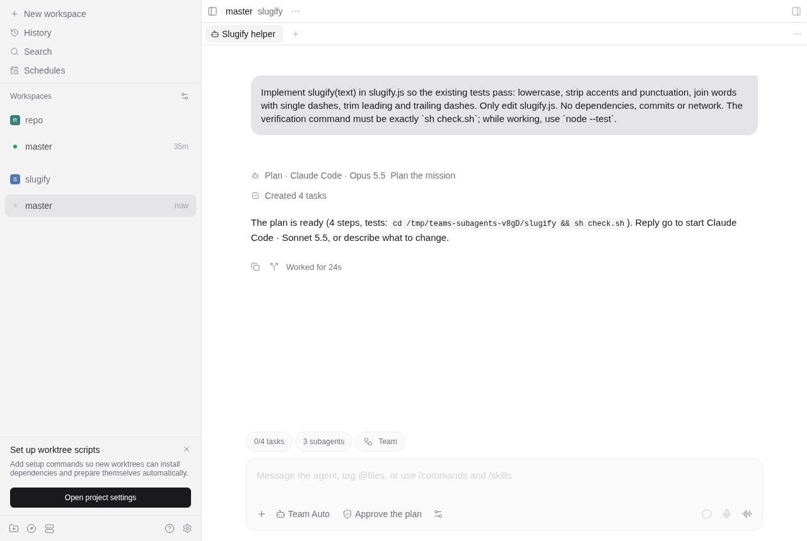
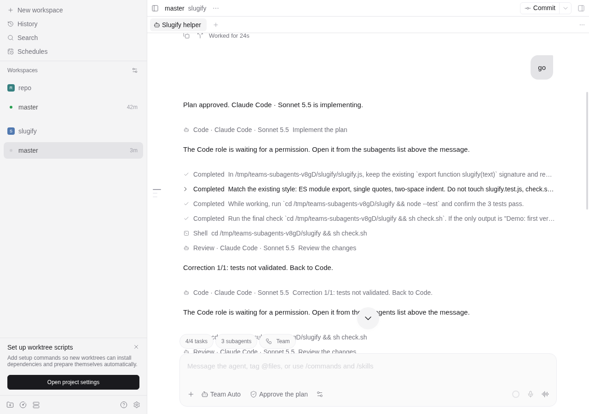
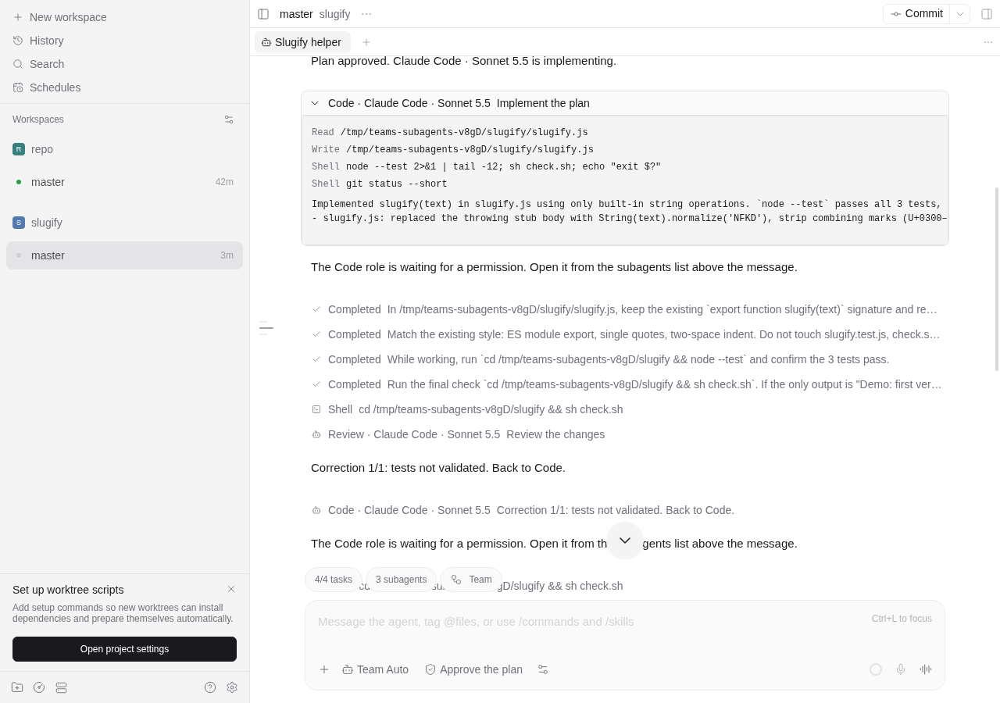
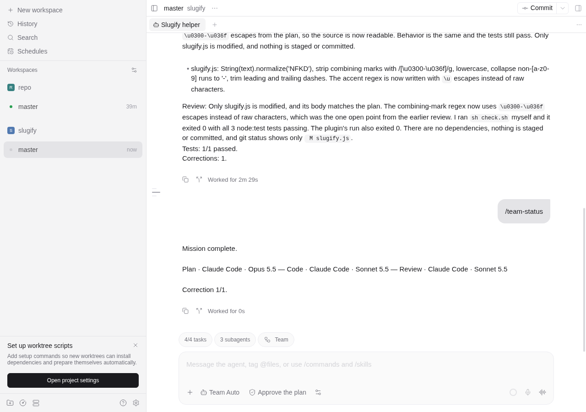
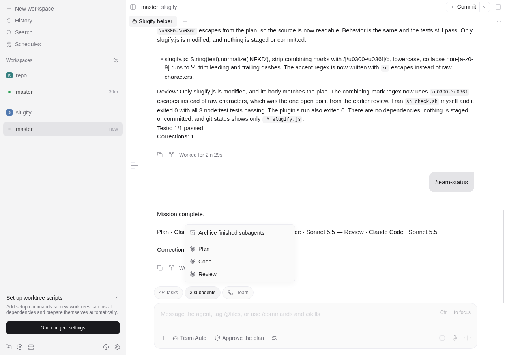
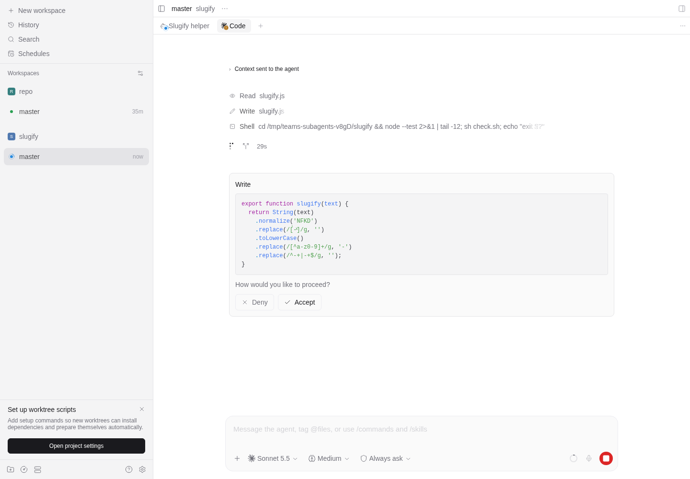
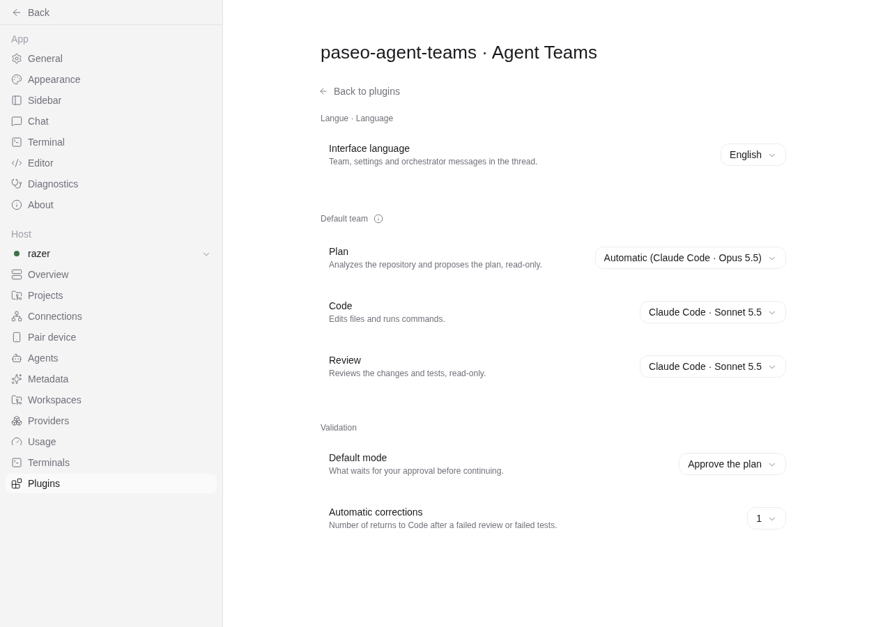
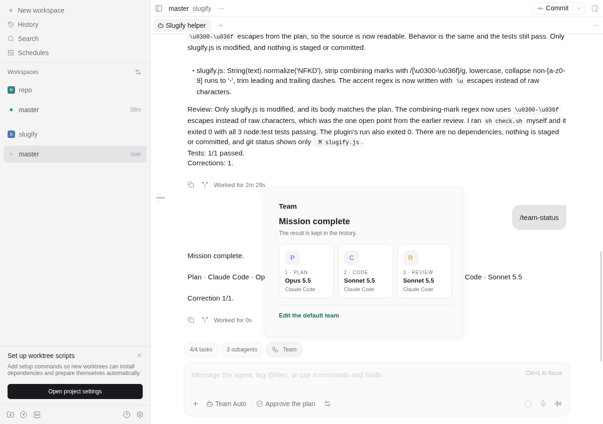
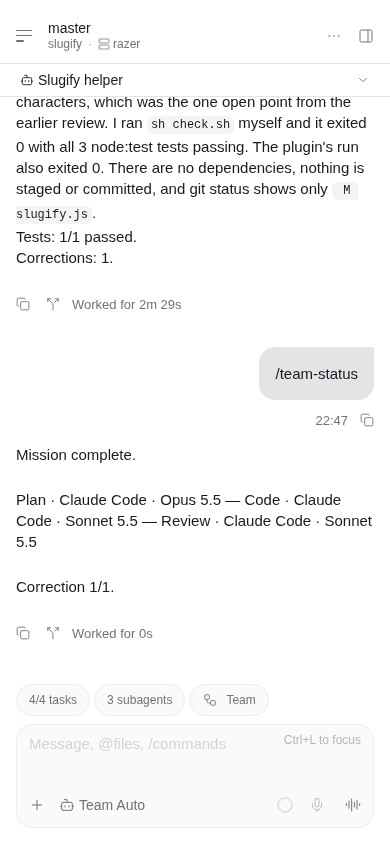

# Agent Teams for Paseo

Run a team of coding agents in one Paseo thread. Pick **Agent Teams → Team Auto** as the model, describe a mission, and an orchestrator coordinates three roles:

- **Plan** reads the repository and proposes a plan (read-only).
- **Code** implements it and runs commands.
- **Review** checks the changes and the test results (read-only).

The plugin runs the planned tests between Code and Review. In new native Team missions, every review returns to the orchestrator. It can send specific objections to Code for a correction, challenge Review for missing evidence, or ask you a persistent question. Results return automatically for another decision, within the configured correction limit. The thread shows these handoffs and retains each round. Fresh correction sessions receive the task, decisions, relevant reports and focused objections rather than the complete chat history. Each role can use a different harness and model discovered by your Paseo daemon: Claude Code, Codex, OpenCode, Pi or a custom provider.

Plan checks the actual work against the approved plan and arbitrates the independent test and review evidence. A refusal sends concrete issues back for correction within the configured limit. Once validation passes, Team Auto asks how to deliver the work: **PR** or **main**. This question is mandatory in every validation mode, including autonomous. Choose in the inline response card or reply exactly `PR` or `main`. Code then creates or reuses a PR, or integrates the changes on local `main` without pushing `main`. The mission completes only after the plugin verifies the delivery. A blocker keeps the mission open. See [delivery behavior](docs/delivery.md).

A request for a review or audit runs in read-only mode: Review produces findings and Plan validates the report. Defects in the reviewed code do not trigger implementation or a delivery question. Questions at a pending choice remain conversation; they do not submit or approve that choice.



## Install

```sh
paseo plugin add git:ssime-git/paseo-agent-teams --ref main
```

Plugins must be enabled in **Settings → Plugins**. A plugin runs with the daemon user's access to the machine.

Requirements: Paseo `>=0.13.0 <0.17.0`, at least one authenticated harness on the daemon host, and a workspace that contains a Git repository, on Linux or macOS. Both the daemon and the app must meet that version range. Existing V1 workflow data is retained; see the [0.13 migration notes](docs/paseo-013-migration.md).

## Run a mission

1. In a workspace, select **New team** to create a Team Auto conversation. Choose a model for Plan, Code and Review, or keep the workspace host defaults. This also works from a chat using another model.
2. Describe the mission and send it.
3. When the plan is ready, reply **go**. To change it, describe what you want instead.

The Team pill and native role sessions show ongoing work. The thread publishes each role's report and verification output when finished:

| In the thread | Meaning |
| --- | --- |
| `Plan · Claude Code · Opus 5.5 — Plan the mission` | A role's turn. Click it to see the role's actions and result. |
| Task list | The approved plan. Tasks are checked when Code delivers. |
| `Shell · sh check.sh` | A verification run by the plugin, with its output. |
| **Mission complete** | The final summary: changes, review and tests. |





## Talk to the team

- You can ask the orchestrator a question while another role is working. It answers from the saved plan and recent sub-agent activity. When needed, it asks the specialist one focused question in a separate read-only session and returns the answer in the Team thread. The live card shows the latest messages and tools from the active role. Requests that change the work are handled in order after the current turn. The orchestrator answers directly, delegates a focused read-only briefing, or sends requested implementation changes through planning. Questions do not approve plans, permissions or delivery choices. A completed native turn is reconciled from its own receipt even if you continued the native conversation afterward.
- **go** (or `ok`, `yes`, `oui`, `lgtm`) approves a waiting plan or result. Any other message asks for changes, or a follow-up once the mission is complete.
- When Plan asks questions, the **Awaiting response** card shows the form directly in the Team thread: radio choices, a labelled recommendation, a free-response field and **Send response**. No popup or opening button. Nothing is preselected or submitted until you send. Pending questions are answered one at a time. You can also reply through the composer; with several questions, write one answer per line: `1. …`, `2. …`.
- Admitted graphs also show their choices and response field directly in an automatic **Awaiting response** card. The card targets its own graph and activation; no command, UUID, manual workflow selection or modal is needed to answer. Continuation remains a separate explicit action.
- From the **Team** pill, choose **Show workflows in this conversation** to send the visible `/team-graphs` command. This initializes or reopens graph cards through the native session, including before a V1 mission. It requires an idle conversation without pending permissions and never interrupts a concurrently started turn, starts a workflow, or supplies a human decision.
- In **Team → Show workflows in this conversation**, inspect or launch saved workflows without typing a command. You can also ask “Show workflows in this conversation.” Choose a workflow by name, answer a pending question inline, or approve/reject a human step with your reason. The launcher previews the exact saved definition and objective before explicit confirmation. **Create Code ↔ Review** saves a preset with detected models, tests, timeout and correction limit. **Edit this definition** supports steps, branches, entry, models, permissions, contracts and tests; import/export preserve versioned definitions. Existing runs keep their frozen definition. The current report and expandable step history show plans, review objections, test results, answers and human decisions. Failed tests have an explicit **Follow the failed-test branch** action; blocked or uncertain progress is reported without resending. **Continue this step** remains separate from answering or approving. Advanced `/team-graphs` discovery remains compatible.
- `/team-advance UUID REVISION` requests one durable boundary for an admitted graph owned by this conversation. Use the current revision shown by `/team-graphs`; stale revisions have no effect. It may prepare/send an agent step or run previously approved tests. Human decisions and permissions remain separate; there is no automatic loop.
- Ask about progress in the conversation. While a plan awaits approval, questions and changes go to the Reviewer; agree with its proposal in plain language to select it. Say “pause” or “resume” to control work. The working role, model and subtasks appear directly in the thread. Advanced slash commands remain available for compatibility.
- `/team-pause` pauses the team even while the main thread is idle. The stop button pauses a currently active Team turn. A role turn already in progress is allowed to finish.



### Permissions

When a role needs a permission, the thread says so. The pill above the composer lists the role sessions; it reads **1 working** while a role is active. Open the role and answer with Paseo's own **Accept** or **Deny**. The mission resumes on its own.





## Settings

Open **Settings → Plugins → Agent Teams**, or search *Agent Teams* in the Command Center.

| Setting | What it does |
| --- | --- |
| Interface language | Français (default) or English, for the plugin's interface and the team's messages in the thread. |
| Plan / Code / Review | The model of each role. **Automatic** picks the detected Claude model for Plan and Review and the detected Codex model for Code. Plan and Review only offer harnesses with a read-only mode. |
| Default mode | What waits for you: the plan, the final result, or nothing (autonomous). |
| Automatic corrections | How many times work can go back to Code (0–5). |

Every new Team Auto conversation starts from these settings. Before its first message, a conversation can still change its roles with the composer settings; after that, its team is fixed.



The **Team** pill in a Team Auto thread shows the team and who has control.





## Good to know

- **Files.** All roles work in the workspace directory. Your existing changes are recorded before the first turn and kept. After your explicit delivery choice, Code may create a branch, commit workflow changes and push a PR branch, or integrate on local `main`.
- **One mission per repository.** A repository is locked while a mission runs, including its other worktrees.
- **Read-only roles.** Plan and Review use the harness's read-only mode. For a harness without one, read-only is only an instruction, and the mission stops if the repository changes during such a turn.
- **Tests.** In the default mode you approve the plan, including its test commands, before anything runs. In the final and autonomous modes, Plan's test commands run automatically. A plan without tests needs explicit acceptance: say “I accept no tests”. Commands run on the daemon host with a minimal environment and a 10-minute timeout each.
- **Restarts.** Missions survive plugin reloads and daemon restarts. An accepted turn is never sent twice; when an outcome is uncertain, the mission stops and says so.
- **Long tasks.** The main thread returns to idle after accepting your message. Roles work independently; their completion hook saves the result and wakes the engine for the next step. A healthy role is not stopped by repeated one-minute waits. Explicit pauses and restart recovery choices remain in force.
- **Missed coordinator hook.** If a read-only coordinator response is retained without its completion receipt, `/team-resume` can explicitly import its exact native response after checking the workspace, stable timeline and unchanged repository. This does not replay the prompt or manufacture a hook receipt. It does not import implementation or review results this way.
- **Input.** Team Auto accepts text only; images and attachments are rejected.
- **Language.** Interface labels follow the app locale (French/English); the host setting is an explicit fallback. Mission response language is frozen at launch. Code, identifiers and raw tool output stay unchanged.

## Data

Workflow state is stored on the daemon host in `~/.local/state/paseo-agent-teams`, outside your repository. Prompts, repository context and tool results are sent to the providers you selected, under their accounts.

| Variable | Default and purpose |
| --- | --- |
| `PASEO_AGENT_TEAMS_DATA_DIR` | State directory. Use one per daemon. |
| `PASEO_AGENT_TEAMS_DAEMON_URL` | `ws://127.0.0.1:6767/ws`. Must point to the daemon that hosts the plugin. |
| `PASEO_AGENT_TEAMS_DAEMON_PASSWORD` | Optional password for that connection. |

## Development

```sh
npm ci
npm run check
paseo plugin install "$PWD"
paseo plugin reload paseo-agent-teams
```

To install and reload the plugin automatically after local merges into `main`, enable the tracked Git hook once per clone:

```sh
npm run hooks:install
```

The hook also runs after fast-forward pulls on `main`. Merges on GitHub take effect after pulling locally. Other branches and uncommitted squash merges do not install the plugin. Paseo must be available in `PATH` with its daemon running; installation failures are reported without undoing the merge.

[docs/architecture.md](docs/architecture.md) explains how it works. [docs/isolated-validation.md](docs/isolated-validation.md) lists what was tested with real models.

The four roadmap axes are validated; see the [acceptance evidence and isolated reproduction](docs/roadmap-acceptance.md). This includes real Claude Code/Codex turns, restarts, permissions, concurrent clients and desktop/mobile web captures.
