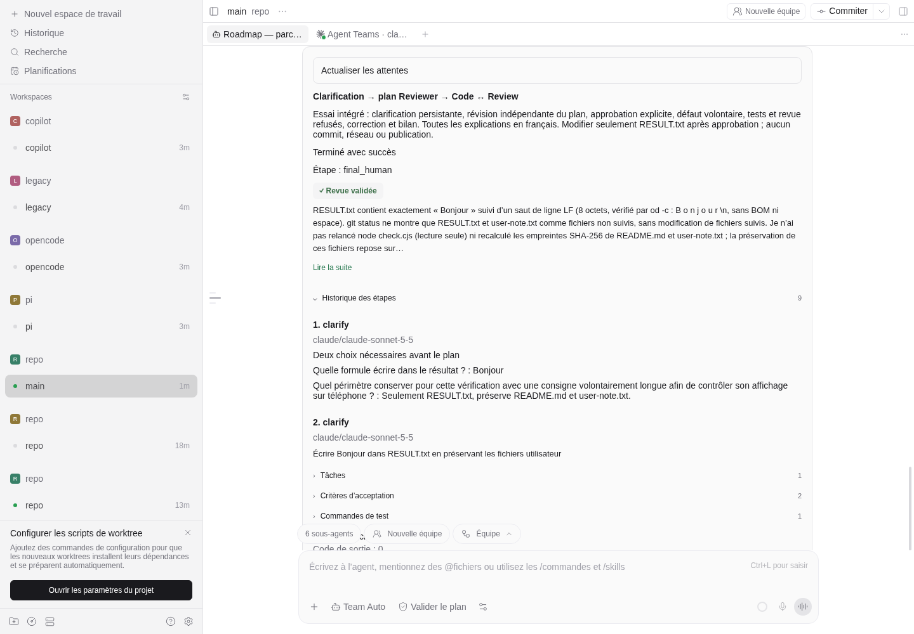

# Validation finale Agent Teams — 20 novembre 2026

Les quatre axes de `scheduled-roadmap.md` sont couverts. La preuve transportable
est [roadmap-acceptance-proof.json](roadmap-acceptance-proof.json). Elle contient
les identifiants des vrais reçus natifs, les résultats des tests indépendants,
les décisions explicites de la fixture et les cas négatifs. Les scripts de
reproduction sont versionnés ; les journaux complets de ce passage se trouvent
dans `/tmp/teams-roadmap-final`.

| Critère | Preuve finale |
| --- | --- |
| Itération Reviewer | Cinq tours réels au total : plan initial, discussion Reviewer, réponse native volontairement invalide refusée, nouveau Reviewer Codex, proposition native finale. Remplacement refusé pendant le tour ; import et adoption concurrents, versions et provenance conservées après redémarrage ; aucune exécution Builder ni approbation implicite. `reviewer.json`, `reviewer-adopt.log`. |
| Clarification différée | Deux questions, recommandation et réponse libre. Premier choix envoyé depuis le navigateur mobile FR ; doublon rejoué sans mutation, réponse contradictoire refusée. Redémarrage avec seulement une réponse, puis réponse libre depuis le navigateur EN. Aucun Code avant les deux réponses et l’approbation du plan. `partial-answer.json`, `path.json`, `answer-*-browser.json`. |
| Parcours intégré | Un seul graphe : clarification → plan → révision Reviewer → accord explicite → défaut contrôlé → test échoué → revue refusée → correction → test et revue validés → bilan humain explicite. Neuf activations, sept vrais tours natifs. `path.json`. |
| Presets et limites | V1 sans nouveaux flags : Plan/Code/Review réels, test indépendant réussi, choix de livraison non approuvé. Preset produit par `codeReviewPreset` : Code puis Reviewer réels ; refus et épuisement du budget de deux activations, sans second Code. `presets.json`. |
| Permissions et reprise | Un vrai Write Claude refusé, fichier intact, aucune permission ni génération restante. La complétion est incertaine : opération conservée, aucun succès inventé ni renvoi. Reprise des checkpoints et prompts natifs comparés après redémarrage. `permission.json`. |
| Deux clients distincts | Deux connexions SDK concurrentes approuvent une même étape humaine : une seule décision acceptée ; rejeu depuis l’autre client identique. La boucle atteint sa limite sans lancer de modèle. `compatibility.json`, section `concurrent`. |
| V1 et harnais | Fixture historique V1 synthétique chargée par le vrai daemon, opération et accord conservés, version `legacy` honnête, aucun nouveau flag activé. Claude Code et Codex exécutés réellement. Copilot, OpenCode et Pi détectés puis refusés avant dispatch pour les analyses de graphe sans sandbox natif vérifié. `compatibility.json`. |
| Interface et langue | Questions et bilan en FR/EN, application web à 1440 × 1000 et 390 × 844, sans débordement ni erreur JavaScript. Réponses de la mission figées en français, libellés du client anglais conservés. Historique, rapports, réponses et tests lisibles dans le fil. `capture-browser.json`, `final-browser.json`. |

Les décisions humaines des essais sont des soumissions explicites de la fixture,
réalisées par le harnais ou par des clics navigateur. Elles ne prétendent pas
être des décisions d’un utilisateur réel. Les cas de défaut, refus et budget
sont volontairement provoqués. Les modèles et commandes, eux, sont réellement
exécutés sur le daemon isolé Paseo 0.16.2. Aucun commentaire, PR ou livraison
externe n’est publié. Les contrôles mobiles utilisent Chromium au format
390 × 844 ; aucun appareil physique iOS/Android n’est revendiqué.



[Vue mobile en anglais](screenshots/roadmap-mobile-en.png) ·
[Question longue et réponse partielle sur mobile](screenshots/roadmap-question-mobile-fr.png)

## Reproduction bornée

Préparer un home et des données jetables, un port loopback différent de 6767,
les vrais harnais authentifiés, le plugin installé depuis ce dépôt, et une
interface web locale. Désactiver voix/dictée dans ce seul home. Ne jamais
redémarrer le daemon principal. Les scripts refusent le port principal et un
fichier de preuve déjà créé ; une tentative incertaine doit être inspectée,
jamais renvoyée aveuglément.

Variables utilisées lors de cet essai :

```bash
export PASEO_TEAMS_SMOKE_URL=ws://127.0.0.1:6923/ws
export PASEO_TEAMS_SMOKE_DATA_DIR=/tmp/teams-roadmap-final/data
export PLAYWRIGHT_MODULE=/tmp/teams-016-mkMLfi/browser/node_modules/playwright-core/index.mjs
export TEAMS_SMOKE_STATUS=/tmp/teams-roadmap-final/status.json
export TEAMS_SMOKE_OUTPUT=/tmp/teams-roadmap-final
```

Le home isolé est `/tmp/teams-roadmap-final/home`. Sa configuration locale
active les plugins et le Web UI, injecte le seul endpoint MCP officiel Paseo,
et écoute sur `127.0.0.1:6923`. Le chemin Playwright dépend de l’installation
locale. Les opérations de redémarrage indiquées ci-dessous concernent ce home
uniquement, avec `PASEO_AGENT_TEAMS_DATA_DIR` et
`PASEO_AGENT_TEAMS_DAEMON_URL` pointant explicitement vers cet essai.

```bash
node scripts/smoke-roadmap.mjs start /tmp/teams-roadmap-final/path.json
node scripts/smoke-roadmap-ui.mjs /tmp/teams-roadmap-final/path.json capture
node scripts/smoke-roadmap-ui.mjs /tmp/teams-roadmap-final/path.json answer-first
node scripts/smoke-reviewer-boundary.mjs start /tmp/teams-roadmap-final/reviewer.json
node scripts/smoke-graph-permission.mjs start /tmp/teams-roadmap-final/permission.json
node scripts/smoke-roadmap-compatibility.mjs seed /tmp/teams-roadmap-final/compatibility.json
node scripts/smoke-roadmap.mjs checkpoint /tmp/teams-roadmap-final/path.json
```

Redémarrer uniquement le daemon isolé, puis vérifier avant toute réponse :

```bash
node scripts/smoke-roadmap.mjs verify /tmp/teams-roadmap-final/path.json
node scripts/smoke-reviewer-boundary.mjs verify /tmp/teams-roadmap-final/reviewer.json
node scripts/smoke-graph-permission.mjs verify /tmp/teams-roadmap-final/permission.json
node scripts/smoke-roadmap-compatibility.mjs verify /tmp/teams-roadmap-final/compatibility.json
node scripts/smoke-roadmap-compatibility.mjs concurrency /tmp/teams-roadmap-final/compatibility.json
node scripts/smoke-roadmap-ui.mjs /tmp/teams-roadmap-final/path.json answer-last
node scripts/smoke-reviewer-boundary.mjs adopt /tmp/teams-roadmap-final/reviewer.json
node scripts/smoke-roadmap.mjs continue /tmp/teams-roadmap-final/path.json
node scripts/smoke-roadmap.mjs approve-plan /tmp/teams-roadmap-final/path.json
node scripts/smoke-roadmap-ui.mjs /tmp/teams-roadmap-final/path.json reject-tests
node scripts/smoke-roadmap.mjs continue /tmp/teams-roadmap-final/path.json
node scripts/smoke-roadmap.mjs checkpoint /tmp/teams-roadmap-final/path.json
```

Redémarrer l’isolé au dernier accord humain, vérifier le checkpoint, puis :

```bash
node scripts/smoke-roadmap.mjs verify /tmp/teams-roadmap-final/path.json
node scripts/smoke-roadmap.mjs approve-final /tmp/teams-roadmap-final/path.json
node scripts/smoke-roadmap-ui.mjs /tmp/teams-roadmap-final/path.json final
node --import tsx scripts/smoke-roadmap-presets.mjs start /tmp/teams-roadmap-final/presets.json
node scripts/smoke-roadmap.mjs checkpoint /tmp/teams-roadmap-final/path.json
```

Un dernier redémarrage isolé vérifie le graphe terminé, les presets, les
versions Reviewer et les opérations conservées. Le mode `verify` de chaque
harnais ne génère aucun nouveau tour. Le mode `continue` du harnais Reviewer
permet de reprendre une préparation enregistrée, sans rejouer le premier tour.
Les budgets sont limités à 150–600 secondes par commande et à onze activations
pour le parcours intégré. Les tests d’intégration restent opt-in : `npm run
check` n’engage aucun modèle.

## Limites de support explicites

Les graphes avancent par des continuations explicites et bornées ; leurs
questions, permissions et accords humains ne sont jamais déduits du silence.
Les boucles des nouvelles missions Team Auto standard sont pilotées
automatiquement par leur orchestrateur. Une analyse de graphe exige actuellement
Codex `read-only` ou Claude `plan`. La découverte d’un autre harnais ne certifie
pas ses garanties de sandbox. Le refus d’un Write natif peut laisser la
complétion incertaine : le plugin conserve alors l’opération et affiche le
blocage, sans fabriquer de reçu ou relancer le prompt.
